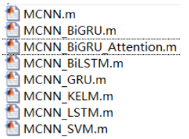
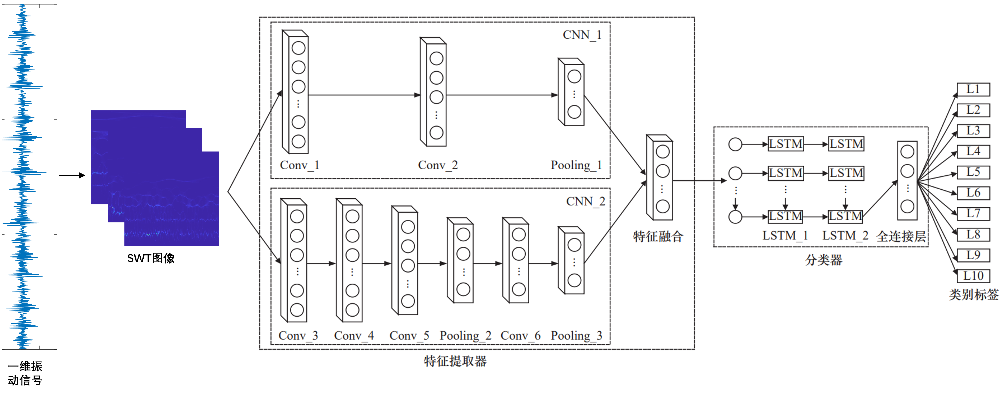
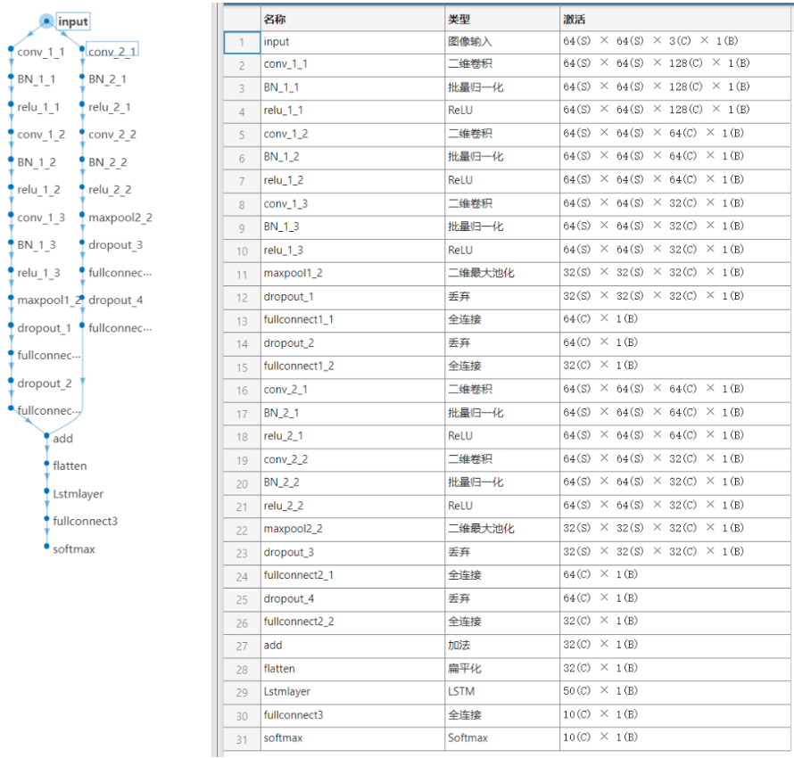
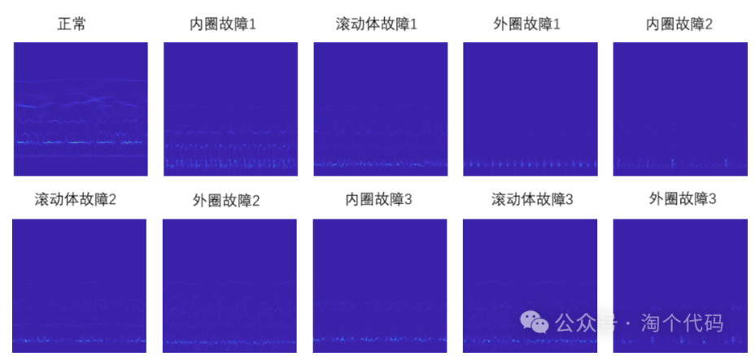
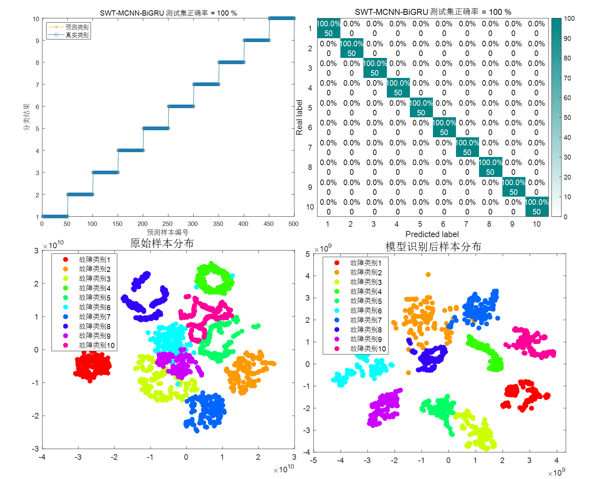
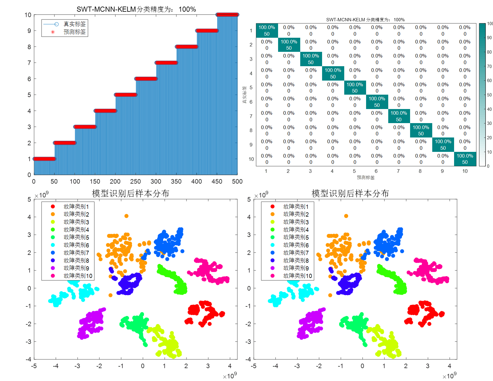
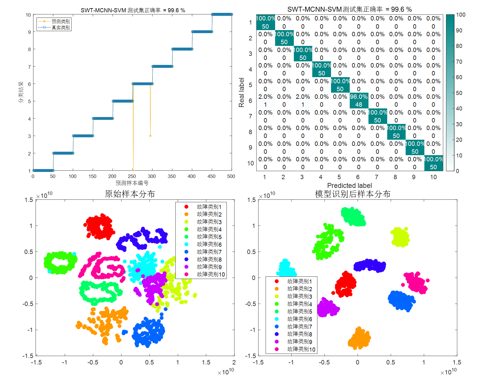
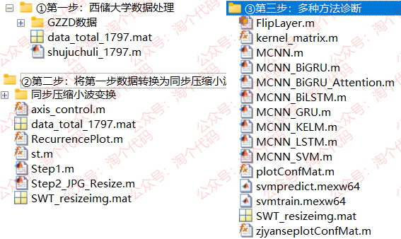
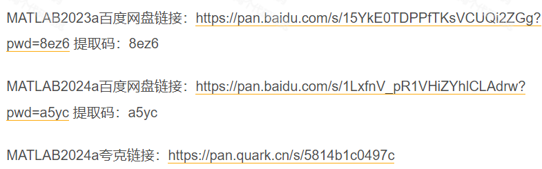

# Multi-Scale Convolution MCNN, MCNN-BiGRU, BiLSTM, KELM, SVM Fault Diagnosis, MATLAB Code

MATLAB2024a Quark link: https://pan.quark.cn/s/5814b1c0497c
This issue introduces a fault diagnosis model that is frequently used and has good performance in the field of fault diagnosis - MCNN (Multi-Scale Convolutional Neural Network). To facilitate learning, this issue has organized different combinations of networks related to MCNN:
\n        \n  
The above-mentioned model can be obtained in one go, the method of obtaining it is moved to the end of the article.
MCNN: Multi-Scale Convolutional Neural Networks (MCNN) are a variant of CNNs, possessing stronger feature extraction capabilities than CNNs. MCNN employs convolutional kernels of varying sizes to extract features, which is beneficial because different size kernels have different receptive fields, thus enabling the extraction of both low-frequency and high-frequency features. By stacking these features together, multi-scale features are formed. When using multi-scale features for model training, results often outperform those obtained with single CNNs.
The network structure built in this period is as follows, taking MCNN-LSTM as an example:
\nMATLAB directly shows the specific parameters of each layer's network units:
\n        \n  
The diagnostic approach for this period is as follows:
1. Process the official downloaded data from Western Reserve University to categorize into 10 types of faults.
② For the data obtained from the first step, feature extraction is conducted using Synchronous Wavelet Transform (SWT), which converts one-dimensional vibration signals into two-dimensional images. SWT possesses multi-scale analysis capabilities, allowing for signal analysis at different scales, thereby providing a more comprehensive frequency information.
3. Utilize the two-dimensional images obtained in Step 2 for cropping and compression, then feed them into the MCNN network and its combination network for training and testing.
Several advantages of the code model provided in this issue:
The product is a one-dimensional image converted to a two-dimensional image using the synchronous compression and perception method, enhancing the fault characteristics.
The "cross-entropy" loss function is selected as the basis for network training.
Training sets, validation sets, and test sets are divided, and during network training, the validation set is used to continuously reduce the loss, which does not affect the generalization ability of the model.
The T-SNE dimensionality reduction method is adopted to visualize the effect of neural network recognition before and after.
Several commonly used and novel networks are combined: MCNN-BiGRU, MCNN-BiGRU-Attention, MCNN-BiLSTM, MCNN-GRU, MCNN -KELM, MCNN-LSTM, MCNN-SVM.
Detailed explanation:
1. Data Processing
Process the official downloaded data from Xiu University of Mining and Technology, following these steps:
Load a total of 10 types of data, then select DE_time (%DE is the driver end data, FE is the fan end data, BA is the acceleration data, choose one of them) for each data.
Set the sliding window w, the number of fault sample points s for each data, and the sample quantity m for each fault type.
After all data sliding windows are completed, integrate them into a single data variable.
As mentioned in previous articles about processing Xiu University of Mining and Technology's bearing diagnosis data, you can refer to this article: Xiu University of Mining and Technology Bearing Diagnosis Data Processing, MATLAB Free Code Acquired.
Finally, the obtained data is a 2000*1024 matrix, where 2000 is the sample size, 1024 is the feature size. 2000 equals 200*10, 10 refers to 10 types of fault states, 200 refers to each state has 200 samples. In the code, it is data_total_1797.mat.
2. SWT Feature Extraction
SWT transformation result:
\n        \n
3. Results Display
This period's model data includes 10 types of states, each with 200 samples. The training set: validation set: test set ratio is (12:3:5), you can also adjust the proportion as needed.

Results display:
Firstly, MCNN network:
\n        \n      MCNN-BiGRU network:
\n        \n      MCNN-KELM network:
\n        \n  
MCNN-SVM network:
\n        \n  
The rest are not displayed one by one, but all have very good results!
Code directory:
\n        \n  
MATLAB version requirements: 2023 and above:
References:
[1] Gong Jun, Zhang Yueyi, Chen Sijie, et al. . Bearing Fault Diagnosis Based on SWT and Improved Convolutional Neural Network [J]. Modern Electronic Technology, 2024, 47(6): 68-74  
[2] Chen Yueran, Mu Li. Bearing Fault Diagnosis Based on MCNN-BiGRU-Attention [J]. Computer System Application, 2023, 32(9): 125-131  
[3] Hu Mengting, Luo Chen. Bearing Fault Diagnosis Based on MCNN-LSTM and Cross Entropy Loss Function [J]. Manufacturing Technology and Machine Tools, 2024, (9): 16-22.

## Images

<!-- PAYMENT_BLOCK -->

## Get this dataset

- Payment link (Stripe): [Buy now](https://buy.stripe.com/3cs8yP7sY87d0vu9AB)
- Payment QR code: 

<!-- /PAYMENT_BLOCK -->
